# Modelos Fundacionales de Series de Tiempo a Escala Big Data para el Pronóstico de Demanda en el Retail de Moda

[](https://www.databricks.com/)
[](https://spark.apache.org/)
[](https://delta.io/)
[](https://mlflow.org/)
[](https://www.python.org/)

Repositorio oficial del trabajo de grado para optar al título de **Magíster en Ciencia de Datos**.

* **Autor:** Diego Alexander Sánchez Henao
* **Director Metodológico y Científico:** Prof. Ferney Orlando Amaya Fernández
* **Institución:** Universidad Pontificia Bolivariana (UPB), Sede Medellín — Escuela de Ingenierías
* **Programa:** Maestría en Ciencia de Datos
* **Grupo de Investigación Anfitrión:** Grupo de Investigaciones en Desarrollo y Aplicación de Telecomunicaciones e Informática ([GIDATIC](https://www.upb.edu.co/es/investigacion/nuestro-sistema/grupos/grupo-investigaciones-desarrollo-aplicacion-telecomunicaciones-informatica-medellin)), Categoría A en Minciencias.

---

## 1. Planteamiento del Problema y Marco PICO

En la industria del retail de moda (*fast fashion* y vestuario), las decisiones operativas de compra, asignación inicial y reabastecimiento dependen de pronosticar la demanda semanal de decenas de miles de combinaciones artículo–canal (`article_id` $\times$ `sales_channel_id`). A diferencia de series macroeconómicas o energéticas, la demanda en moda presenta tres desafíos estructurales severos ([Swaminathan y Venkitasubramony, 2024](https://doi.org/10.1016/j.ijforecast.2023.02.005)):

1. **Ciclos de vida cortos:** Referencias que permanecen activas únicamente entre 1 y 2 temporadas comerciales.
2. **Alta intermitencia y volatilidad (*Lumpy / Intermittent Demand*):** Abundancia de semanas con demanda cero intercaladas con picos promocionales.
3. **Arranque en frío (*Cold Start*):** Lanzamiento continuo de productos nuevos con historial nulo o inferior a 6 semanas.

Aunque desde 2024 han surgido **Modelos Fundacionales de Series de Tiempo (TSFM)** pre-entrenados con miles de millones de observaciones que prometen pronóstico *zero-shot*, la literatura reporta tensiones críticas: en competencias como M5 los modelos globales supervisados basados en árboles (**LightGBM**) mantienen ventajas competitivas ([Makridakis et al., 2022a](https://doi.org/10.1016/j.ijforecast.2021.11.013)), el dominio retail representa menos del $1\%$ de los corpus de pre-entrenamiento público ([Woo et al., 2024](https://proceedings.mlr.press/v235/woo24a.html); [Shi et al., 2025](https://openreview.net/forum?id=e1wDDFmlVu)), y benchmarks clásicos como **M5** o **Favorita** forman parte de los datos de pre-entrenamiento de varios TSFM, contaminando su evaluación *zero-shot*.

### Síntesis de la Pregunta de Investigación (Marco PICO)

| Componente | Definición Metodológica en el Proyecto |
| :--- | :--- |
| **P (Población)** | Series de demanda semanal por artículo (`article_id`) y canal (`sales_channel_id`) en el retail de moda, estratificadas según la matriz Syntetos-Boylan ($ADI$, $CV^2$) en regímenes `Smooth`, `Erratic`, `Intermittent`, `Lumpy` y `Cold_Start`. |
| **I (Intervención)** | Modelos fundacionales de series de tiempo de pesos abiertos (**Chronos-Bolt**, **Chronos-2**, **ChronosX**, **TimesFM** y **Moirai**) evaluados en tres modalidades: (i) *zero-shot* univariado, (ii) *zero-shot* con covariables exógenas (precio, descuento, canal y calendario comercial) y (iii) adaptación eficiente de parámetros mediante **LoRA (PEFT)**. |
| **C (Comparación)** | Modelo global supervisado **LightGBM** (`MLForecast`) y modelos estadísticos clásicos por serie (**Croston Classic**, **Croston SBA**, **TSB**, **AutoETS** y **SeasonalNaive** vía `StatsForecast`). |
| **O (Outcomes)** | **1. Precisión puntual y probabilística:** WAPE, MASE y WQL (P10, P50, P90).<br>**2. Impacto en inventario (*Decision-Aware*):** Sesgo (*Forecast Bias*), nivel de servicio efectivo (*Fill Rate*), ventas perdidas (*Lost Sales*) y sobre-stock promedio (*Overstock*).<br>**3. Escalabilidad Big Data:** Tiempo y costo computacional normalizado por cada **1.000 series** en Apache Spark para escalas de $1.000$, $10.000$ y $100.000$ series. |

---

## 2. Arquitectura Lakehouse en Databricks (Medallion + Unity Catalog)

El proyecto implementa una arquitectura **Medallion (Bronze $\rightarrow$ Silver $\rightarrow$ Gold)** gobernada en **Unity Catalog** (`workspace.fashion_forecasting`) y versionada mediante **Databricks Git Folders**:

```mermaid
flowchart LR
    subgraph Raw["Unity Catalog Volume (raw_data)"]
        A1["H&M (31.8M tx)"]
        A2["VISUELLE (Cold Start)"]
        A3["M5 (Control) / Retailer Local"]
    end

    subgraph Bronze["Capa Bronze (Delta Lake)"]
        B1["bronze_hm_transactions\n(SHA-256 Ley 1581)"]
        B2["bronze_hm_articles"]
        B3["bronze_visuelle"]
    end

    subgraph Silver["Capa Silver (Feature Store & Regímenes)"]
        S1["silver_fashion_weekly_panel\n(Relleno explícito de ceros + Covariables)"]
        S2["silver_regime_catalog\n(ADI, CV2: Smooth, Erratic,\nIntermittent, Lumpy, Cold_Start)"]
    end

    subgraph Gold["Capa Gold (Inferencia, Inventario y Decisión)"]
        G1["gold_forecasts_baselines\n(Croston, SBA, TSB, ETS, LightGBM)"]
        G2["gold_forecasts_tsfm\n(Chronos, TimesFM, Moirai, LoRA)"]
        G3["gold_benchmark_summary &\ngold_decision_matrix"]
    end

    Raw --> Bronze --> Silver --> Gold
```



---

## 3. Conjuntos de Datos y Gobernanza Legal

| Rol en la Tesis | Conjunto de Datos | Escala y Características | Gobernanza y Tratamiento en el Pipeline |
| :--- | :--- | :--- | :--- |
| **Caso Principal (Libre de Contaminación)** | **H&M Personalized Fashion Recommendations** | 31,8M de transacciones diarias, 105.542 artículos, 2 canales (2018–2020). | Agregación semanal balanceada, reconstrucción explícita de semanas con demanda `0` dentro del ciclo de vida activo y cálculo de precios/descuentos. |
| **Arranque en Frío Puro (*Cold Start*)** | **VISUELLE** (Nunalie, Italia) | 5.577 referencias nuevas en 100 tiendas, series de 12 semanas con atributos visuales/textiles y Google Trends. | Evaluación específica del pronóstico en las primeras 6–12 semanas tras el lanzamiento sin historial extenso. |
| **Control Metodológico Externo** | **M5 Forecasting (Walmart)** | 42.840 series jerárquicas con precios y eventos SNAP. | Marcado explícito de **contaminación de pre-entrenamiento** en los corpus LOTSA y Chronos; utilizado exclusivamente como referencia de control. |
| **Conector Empresarial Colombia** | **Plantilla Retailer Local** (Grupo Éxito / Inexmoda / CCM) | Transacciones semanales por SKU, tienda y canal en Colombia. | Anonimización criptográfica **SHA-256 con sal** sobre identificadores sensibles en la capa Bronze para cumplimiento estricto de la **Ley Estatutaria 1581 de 2012**, **CONPES 3920** y **CONPES 4144 de 2025**. |

---

## 4. Estructura del Repositorio

```text
tesis-tsfm-retail-moda-databricks/
├── README.md                                      # Documentación general y académica del proyecto
├── GUIA_PASO_A_PASO_DATABRICKS.md                 # Manual detallado paso a paso desde cero (GitHub + Databricks)
├── requirements.txt                               # Dependencias compatibles con Databricks Runtime ML / Serverless
├── .gitignore                                     # Exclusión de datos pesados, artefactos temporales y credenciales
├── configs/
│   └── experiment_config.yaml                     # Configuración central (Unity Catalog, horizontes, modelos, inventario)
├── src/
│   └── fashion_tsfm/
│       ├── __init__.py                            # Inicialización y exportación del paquete modular
│       ├── config.py                              # Lector YAML, gestor de rutas y DDL de Unity Catalog
│       ├── regime_classifier.py                   # Clasificador Syntetos-Boylan (ADI, CV2) y Cold Start en PySpark/Pandas
│       ├── metrics_and_inventory.py               # WAPE, MASE, WQL, Bias y simulación operativa de inventario (R, S)
│       └── cost_profiler.py                       # Medidor de throughput, costo por 1.000 series y logger de MLflow
└── notebooks/
    ├── 00_setup_and_smoke_test_generator.py       # Creación de esquema/volumen y generador sintético (500 artículos x 2 canales)
    ├── 01_bronze_ingestion_hm_visuelle.py         # Ingesta distribuida, validación y anonimización Ley 1581 -> Bronze
    ├── 02_silver_weekly_panel_and_regimes.py      # Panel semanal balanceado, relleno de ceros, covariables y regímenes -> Silver
    ├── 03_baselines_stats_and_lightgbm.py         # Baselines estadísticos (StatsForecast) y LightGBM global (MLForecast) -> Gold
    ├── 04_tsfm_zeroshot_and_covariates.py         # Inferencia Zero-Shot, Covariables y escalamiento Big Data (Chronos, TimesFM, Moirai)
    ├── 05_tsfm_lora_finetuning.py                 # Ajuste fino eficiente con LoRA (PEFT) sobre series de moda -> Gold
    └── 06_gold_evaluation_and_decision_matrix.py  # Consolidación, simulación Fill Rate, gráficas de tesis y matriz de decisión
```

---

## 5. Ejecución Rápida (*Quick Start*)

1. **Clonar en Databricks Git Folders:** Importa este repositorio desde tu cuenta de Databricks (`Workspace -> Users -> tu_usuario -> Create -> Git folder`).
2. **Modo Prueba Rápida (*Smoke Test* en 3 minutos):** Por defecto, `configs/experiment_config.yaml` tiene `use_smoke_test: true`. Ejecuta en orden los notebooks `00` al `06` para validar el pipeline completo con datos sintéticos realistas sin necesidad de cargar inicialmente los 31,8 millones de registros.
3. **Modo Experimento Completo (H&M / VISUELLE):** Sube los archivos al volumen `/Volumes/workspace/fashion_forecasting/raw_data/`, cambia `use_smoke_test: false` en `configs/experiment_config.yaml` y ejecuta los notebooks `01` al `06`.

> **¿Primera vez en Databricks?** Consulta el manual completo en [`GUIA_PASO_A_PASO_DATABRICKS.md`](./GUIA_PASO_A_PASO_DATABRICKS.md), diseñado clic por clic para configurar GitHub, Unity Catalog, Serverless Compute y MLflow desde cero.

